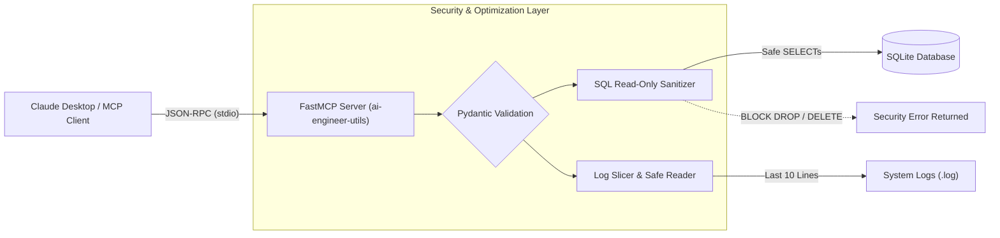

# 🛠️ ai-engineer-utils

<p align="center">
  <strong>Production-Grade Model Context Protocol (MCP) Server for Secure AI Engineering Workflows</strong>
</p>

<p align="center">
  <a href="https://modelcontextprotocol.io/"></a>
  <a href="https://github.com/jlowin/fastmcp"></a>
  <a href="https://docs.pydantic.dev/"></a>
  <a href="https://docs.astral.sh/uv/"></a>
  <a href="https://www.sqlite.org/"></a>
  <a href="https://python.org"></a>
  <a href="#license"></a>
</p>

---

## 📌 Overview

**`ai-engineer-utils`** is a production-grade [Model Context Protocol (MCP)](https://modelcontextprotocol.io/) utility server engineered to bridge the gap between theoretical LLM tool-calling concepts and secure, real-world AI software engineering.

While modern Large Language Models (LLMs) excel at reasoning and generating SQL queries or log analysis scripts, connecting an autonomous agent directly to live infrastructure introduces critical operational hazards:
1. **Destructive Database Operations:** Agents can hallucinate or inadvertently execute `DROP TABLE`, `DELETE`, or `TRUNCATE` commands.
2. **Context Window Exhaustion:** Ingesting multi-megabyte log files floods LLM context buffers, spiking token costs and degrading model reasoning performance.

`ai-engineer-utils` addresses these challenges by encapsulating sensitive infrastructure operations inside high-integrity tool boundaries. Powered by **FastMCP** and typed with strict **Pydantic** validation, this server exposes hardened tools that enforce deterministic security guardrails before touching any underlying resource.



---

## 🔒 Key Features & Security Guardrails

The server exposes two essential AI engineering tools, each engineered with defensive mechanisms:

| Tool Name | Parameters | Return Type | Primary Purpose | Security Guardrail / Safeguard |
| :--- | :--- | :--- | :--- | :--- |
| **`query_database`** | `query: str` | `str` | Execute analytical queries over SQLite tables | **SQL Read-Only Enforcer:** Blocks non-`SELECT` statements (`DROP`, `DELETE`, `UPDATE`, `INSERT`, `ALTER`, etc.). |
| **`read_system_logs`** | `log_path: str` | `str` | Inspect local runtime or diagnostic logs | **Tail-10 Slicer:** Returns only the final 10 lines of the target file to prevent context window overflow. |

### 1. Database Security Guardrail (`query_database`)
- **Strict Read-Only Enforcement:** Inputs are stripped and case-normalized. Any SQL statement that does not strictly start with `SELECT` is immediately rejected at the server level, preventing accidental data loss or SQL injection hazards.
- **Controlled Execution:** Queries are isolated to the target database with automated connection cleanup and structured error boundaries.
- **Pydantic Field Metadata:** Detailed schema annotations inform the LLM of exactly what input is expected, minimizing syntax errors.

### 2. Context Window & Log Guardrail (`read_system_logs`)
- **Context Budget Protection:** Instead of loading full unbounded log files into memory and blowing through token budgets, the tool slices the last 10 lines (`lines[-10:]`).
- **Filesystem Verification:** Verifies file existence prior to IO operations via `os.path.exists()` and fails gracefully with human-readable error messages.
- **Character Encoding Safety:** Reads files using explicit `utf-8` decoding to prevent process crashes caused by binary artifacts or malformed characters.

---

## 🧰 Tech Stack

| Technology | Role | Rationale |
| :--- | :--- | :--- |
| **[Python 3.10+](https://www.python.org/)** | Core Runtime | High-level language standard for AI engineering, tooling, and data manipulation. |
| **[FastMCP](https://github.com/jlowin/fastmcp)** | MCP Framework | Ergonomic, high-performance Python framework for creating standards-compliant MCP servers. |
| **[Pydantic v2](https://docs.pydantic.dev/)** | Data Validation | High-speed schema generation and runtime parameter validation for LLM tool calls. |
| **[SQLite3](https://www.sqlite.org/)** | Embedded Database | Zero-configuration, lightweight, ACID-compliant relational data store. |
| **[uv](https://docs.astral.sh/uv/)** | Package & Environment Manager | Blazing-fast Rust-based Python package manager for reproducible dependency resolution. |

---

## 📁 Project Architecture & File Structure

```text
ai-engineer-mcp/
├── .python-version       # Managed Python interpreter version pin
├── pyproject.toml        # Project metadata, dependencies, and build specs
├── uv.lock               # Deterministic dependency lockfile
├── main.py               # Core MCP server entry point and tool definitions
├── test.db               # SQLite database instance initialized with sample records
└── README.md             # Project documentation and architectural guide
```

### Architectural Flow

1. **Host Boot:** `main.py` initializes the `FastMCP` instance, bootstrapping the local database schema (`projects` table) if not already present.
2. **RPC Dispatch:** When an LLM client communicates over standard I/O (`stdio`), FastMCP routes tool calls to the matching decorated function.
3. **Guardrail Interception:** Arguments pass through Pydantic type checks, followed by domain-specific security checks (e.g., verifying `clean_query.startswith("select")`).
4. **Structured Response:** Safe payloads or diagnostic error messages are serialized back to the client as standard JSON-RPC strings.

---

## 🚀 Installation & Setup Guide

This project leverages [uv](https://docs.astral.sh/uv/) for ultra-fast dependency management and virtual environment orchestration.

### Prerequisites

- **Python:** Python 3.10+ (tested through 3.14)
- **uv:** Install uv via the official installer:
  - **macOS / Linux:**
    ```bash
    curl -LsSf https://astral.sh/uv/install.sh | sh
    ```
  - **Windows (PowerShell):**
    ```powershell
    powershell -ExecutionPolicy ByPass -c "irm https://astral.sh/uv/install.ps1 | iex"
    ```
- **Node.js (Optional):** Required only if running the web-based MCP Inspector (`npx`).

### Step-by-Step Setup

1. **Clone the repository:**
   ```bash
   git clone https://github.com/humammoin09-blip/ai-engineer-utils.git
   cd ai-engineer-utils
   ```

2. **Initialize or sync the environment:**
   If initializing from scratch:
   ```bash
   uv init
   uv add "fastmcp>=4.1.3" "pydantic>=2.14.1"
   ```
   Or if using the existing lockfile:
   ```bash
   uv sync
   ```

3. **Run the MCP server directly:**
   ```bash
   uv run fastmcp run main.py
   ```

   *Output confirms the FastMCP server is active and awaiting JSON-RPC traffic on `stdio`.*

---

## 🔬 Testing with MCP Inspector

The official [Model Context Protocol Inspector](https://github.com/modelcontextprotocol/inspector) provides an interactive browser-based UI to inspect schemas, execute tools, and verify guardrails without connecting a full desktop client.

Run the inspector directly through `npx`:

```bash
npx @modelcontextprotocol/inspector uv run fastmcp run main.py
```

### Interactive Verification Steps

1. Open your browser and navigate to the local inspector UI:
   ```text
   http://localhost:6274
   ```
2. In the inspector dashboard, verify that both tools appear under the **Tools** tab:
   - `query_database`
   - `read_system_logs`
3. **Test `query_database` Guardrail:**
   - **Valid Query:**
     ```sql
     SELECT * FROM projects;
     ```
     *Expected Response:* `[(1, 'SidekickAI', 'Active'), (2, 'WorldMonitor', 'In Progress')]`
   - **Blocked Query (Security Guardrail in Action):**
     ```sql
     DROP TABLE projects;
     ```
     *Expected Response:* `Security Error: Only SELECT queries are allowed on this database.`
4. **Test `read_system_logs` Safeguard:**
   - Pass a valid log file path (e.g. `main.py` or a sample log) to confirm that only the last 10 lines are returned.
   - Pass an invalid path to confirm graceful failure: `Error: Log file not found at path '...'`.

---

## 🖥️ Claude Desktop Integration

To expose `ai-engineer-utils` to Claude Desktop, configure the MCP settings file on your system.

### Configuration File Locations

- **macOS:** `~/Library/Application Support/Claude/claude_desktop_config.json`
- **Windows:** `%APPDATA%\Claude\claude_desktop_config.json`

### Configuration Snippet

Add the `ai-engineer-utils` server entry under `mcpServers`:

#### Windows Configuration
```json
{
  "mcpServers": {
    "ai-engineer-utils": {
      "command": "uv",
      "args": [
        "--directory",
        "C:\\Users\\pc\\ai-engineer-mcp",
        "run",
        "fastmcp",
        "run",
        "main.py"
      ]
    }
  }
}
```

> **Note for Windows Users:** Be sure to escape backslashes (`\\`) in file paths or use forward slashes (`C:/Users/pc/ai-engineer-mcp`). Ensure `uv` is accessible within your system `%PATH%`.

#### macOS / Linux Configuration
```json
{
  "mcpServers": {
    "ai-engineer-utils": {
      "command": "uv",
      "args": [
        "--directory",
        "/absolute/path/to/ai-engineer-utils",
        "run",
        "fastmcp",
        "run",
        "main.py"
      ]
    }
  }
}
```

### Verifying Claude Integration

1. Completely quit and restart **Claude Desktop**.
2. Look for the **Hammer (Tools) Icon** 🔨 at the bottom right corner of the chat input box.
3. You will see `query_database` and `read_system_logs` registered and ready to assist your conversations!

---

## 👤 Author

**Humam Moin**  
- **GitHub:** [@humammoin09-blip](https://github.com/humammoin09-blip)  

---

## 📄 License

This project is licensed under the [MIT License](LICENSE) — feel free to use, modify, and distribute it in your own AI engineering projects.
